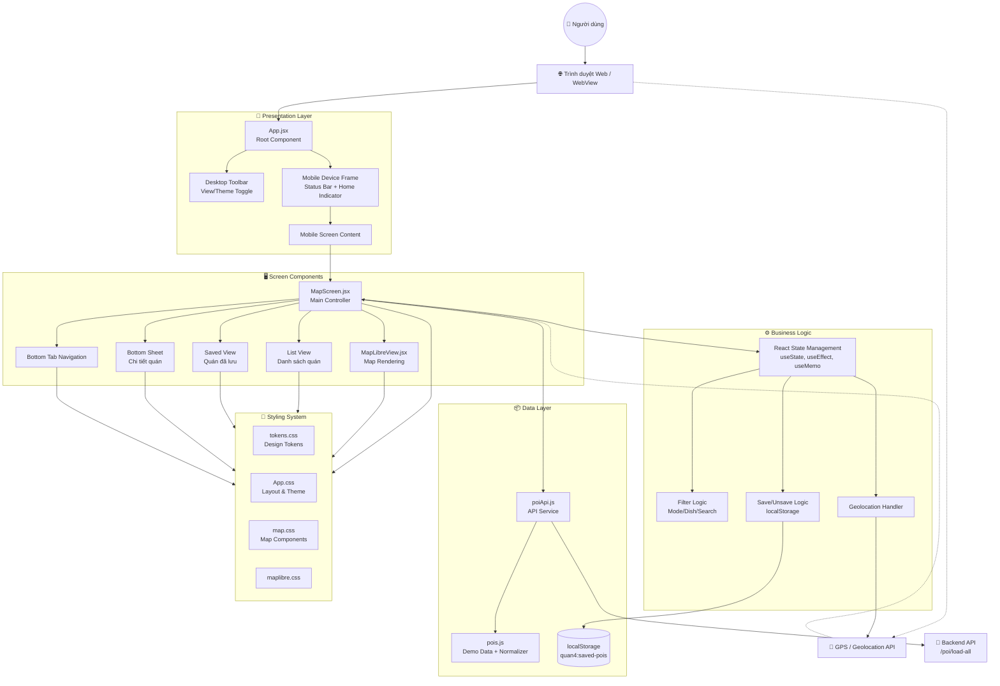
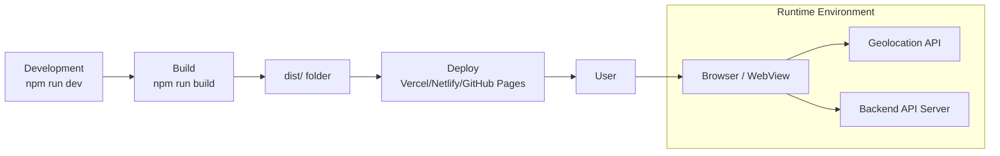

# Mobile Project - Block Flow Diagram (BFD)

## System Architecture Overview



## Data Flow Description

### 1. **Initialization Flow**
```
App Mount → MapScreen Mount → loadPois() → Backend API
                                              ↓
                    Success: API Data → Normalize → State
                                              ↓
                    Failure: Demo Data → Normalize → State
```

### 2. **User Interaction Flow**
```
User Action (Tap/Filter/Search)
    ↓
MapScreen State Update
    ↓
Filter Logic (Mode + Category + Search)
    ↓
Visible POIs Computed (useMemo)
    ↓
Render: MapView / ListView / SavedView
```

### 3. **Map Interaction Flow**
```
User taps marker on MapLibreView
    ↓
onSelect(poiId) callback
    ↓
MapScreen: setSelectedMarker(poi)
    ↓
Bottom Sheet renders with POI details
```

### 4. **Save/Unsave Flow**
```
User clicks heart icon
    ↓
toggleSave(id) → Update savedIds state
    ↓
localStorage.setItem('quan4:saved-pois')
    ↓
UI updates (List/Saved tabs, Bottom Sheet)
```

### 5. **Geolocation Flow**
```
User clicks location button
    ↓
navigator.geolocation.getCurrentPosition()
    ↓
Success: Map flies to user location
    ↓
Error: Shows permission/location error message
```

## Component Responsibilities

| Component | Responsibility |
|-----------|---------------|
| **App.jsx** | Root layout, theme/view mode, device frame simulation |
| **MapScreen.jsx** | Main controller, state orchestration, tab management |
| **MapLibreView.jsx** | MapLibre GL rendering, marker clustering, interactions |
| **poiApi.js** | API communication, timeout handling, fallback to demo data |
| **pois.js** | Demo data, POI normalization, category icons |
| **tokens.css** | Design system (colors, spacing, typography) |

## Technology Stack

- **Framework**: React 18 + Vite
- **Map**: MapLibre GL JS
- **State**: React Hooks (useState, useEffect, useMemo, useCallback)
- **Storage**: localStorage for favorites
- **API**: Fetch API with AbortController
- **Styling**: CSS Custom Properties + CSS Modules pattern
- **Icons**: Inline SVG + Emoji

## Deployment View

